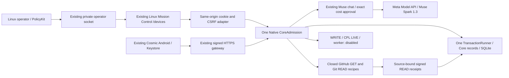

# AIOA spArkHAT — ONE SYSTEM RELEASE STATUS

2026-11-04. Pre-merge owner handoff; one canonical application and repository.

**Decision: CONDITIONAL GO for final code review; release/demo remains BLOCKED
on renewed native admission and physical acceptance. Main has not been merged.**
No claim of AGENT_READY, GitHub WRITE, CPL LIVE or autonomous execution is made.

## Canonical source and deployment identities

| Identity | Exact value |
|---|---|
| Canonical repository | https://github.com/luciferprosun/AIOA-spArkHAT |
| Final release branch | `main` |
| Observed remote main | `bda9d3126150b7c44f94d923ed236e10de5dba59` |
| Reviewed transport source | `7f75021d1cce566d96e3d2271ee99397af425c71` |
| Reviewed source capsule | `f64f8bfd4cec3f2f015daf6390a1e56416c1270c46cfe3d7180aa307ad1deb65` |
| Existing PR40 source branch | `feat/cosmic4-muse-chat-20261103` |
| Existing local integration branch | `feat/ultra-one-system-20261104` |
| Only integration path to main | https://github.com/luciferprosun/AIOA-spArkHAT/pull/40 |
| Active immutable Native source | `9e7dd3f1ea7f03a61b7aac9e67e93f605b74e7e1` |
| Active Native capsule | `c4588381ea9b0d53f8df2c7ab4b0868f0cb90e962198c68d227b3ed340a4637c` |
| Retained Native rollback source | `b7f4002b2a945a52e8ae08b66fc6b4ceeb418f54` |
| Existing Android delivery source | `613737fc2b012594525e51664b24593f040e7a4a` |

This report can be committed in a documentation successor of the reviewed source.
Its exact commit/CI status must be read from PR40. Documentation successors do not
change the sealed source capsule above. Git source SHA remains a separate native
binding: a main merge or documentation HEAD must never be silently substituted
for the active Native SHA or a previously authorized model request.

No repository, integration branch, frontend, Core, approval database, journal or
runtime installation was added for this owner update. The canonical `runtime/`,
`web/`, `clients/`, `tests/` and package/Gradle trees are preserved.

## Actual runtime state

The same Native process, PID1301159/start_ticks59533443, remains on private
`127.0.0.1:4317`, from immutable `ultra-native-9e7dd3f-20261104`. Its state remains
`/home/l/.local/state/aioa-mobile-native-main-20261102`; SQLite, host signing key,
TLS certificate and key were preserved. Protected4314/4316 processes and the
existing userspace Tailscale transport were not restarted. Public Funnel remains
disabled. No pairing reset or Android installation occurred.

The real Native console was opened in Chrome:1920×960, no horizontal overflow,
source9e7, existing `/devices` page. A screenshot and viewport proof are retained
privately. This proves an actual Native page render, not a successful new chat.

**Current authority is not valid.** Native admission was genuinely granted using
PolicyKit around07:50UTC, with its existing one-hour lease. A later private-socket
status read returned `NATIVE_OPERATOR_DENIED_OR_UNKNOWN`. There is no in-place
reauthentication interface. The owner's no-interruption instruction was respected:
no timer edit, forged admission, process restart or competing Core was used.

The new transport code is committed and tested but **not deployed** into that
running host. Current-source LIVE acceptance therefore remains outstanding.

## One existing composition



The diagram's chat route is implemented and historically live-tested; a fresh
approved turn on the reviewed source has not passed. Muse output is advisory
data. A typed `issue.create` proposal grants no approval or execution authority.

## Integrated modules and actual capability limits

| Module / canonical path | Current binding and evidence | Capability |
|---|---|---|
| Native Core — `runtime/core_admission.py`, `runtime/meta_hackathon/runtime_adapter.py` | One real PolicyKit admission; source/TLS/lease checks; lease currently refused | IMPLEMENTED; CURRENT ADMISSION BLOCKED |
| Persistence — `runtime/memory_patch/persistence/ports.py` | Same TransactionRunner, CAS, AUDIT, OUTBOX and existing `core-records.sqlite3` | INTEGRATED; no second store |
| Authority — `runtime/mission/warrant.py`, `intent.py`, `governor.py`, `liability.py`, `runtime/service_guard/` | Existing exact approval/warrant/UNKNOWN boundaries reused | INTEGRATED; unresolved liability preserved |
| Muse — `runtime/providers/meta_model_api.py`, `config.py`, `meta_hackathon/chat.py` | Meta-only `muse-spark-1.3`; historical real receipt; every new message needs exact native cost approval | HISTORICAL LIVE; FRESH SOURCE TEST BLOCKED |
| Human approval — `runtime/mobile_gateway/operator_chat.py` | UID-authenticated socket, real PolicyKit and native checkbox; HTTP/Android cannot approve cost | INTEGRATED; no approval bypass |
| Linux Mission Control — `web/index.html`, `styles.css`, `mobile_devices*.js`, `mobile_chat.js` | Existing English White Hole layout, navigation, device/chat evidence; real9e7 render plus contained browser tests | IMPLEMENTED; renewed current operator required |
| Android — `clients/android/` | Existing Cosmic4 package, Keystore, trusted host store and session recovery; no source or installation change | PRESERVED; fresh physical test NOT_RUN |
| Pairing/TLS — `runtime/mobile_gateway/{pairing,service,wire}.py` | Same host identity, signed nonce/expiry protocol, private Tailscale443→TLS4317 | PRESERVED; online peer is not phone acceptance |
| GitHub READ — `runtime/mcp_bridge/native_read.py`, `meta_hackathon/native_tools.py` | Real Core repository GET with verified signed receipt on9e7; current correction offline-tested | VERIFIED OBSERVATION ON9e7; NEW SOURCE NOT_DEPLOYED |
| GitHub issues and local Git recipes — same closed adapter | Fixed issues/status/log/branches; no model-supplied URL/argv; isolated tests | IMPLEMENTED; individual real Core operations NOT_RUN |
| MCP — `runtime/mcp_bridge/{contracts,adapter,policy,read_ops,task_bus}.py` | Existing contracts/validator reused, no new MCP server or transport | INTEGRATED CONTRACTS; not arbitrary tool authority |
| GitHub WRITE | No registered remote mutation executor; owner UNKNOWN and missing remote START binding | BLOCKED, disabled |
| Critical Prompt Loop — `runtime/critical_loop/`, `runtime/mission/lite_cpl.py` | Existing contracts visible; Native provider/group budget/receipt binding absent | BLOCKED_NATIVE_CPL_NOT_BOUND |
| Mission Worker — `runtime/mission/{jobs,completion,tools,sandbox_linux}.py` | Existing jobs/sandbox contracts remain; Native worker not bound; fixture guard preserved | BLOCKED_NATIVE_WORKER_NOT_BOUND |
| Cockroach — `runtime/memory_patch/adapters/cockroach/` | Existing alternative adapters for the same ports; Native currently uses SQLite | IMPLEMENTED ADAPTERS; production/TLS/RLS/HA qualification NOT_VERIFIED |
| Security/provenance/tests | Existing source capsule, exact principal/scope, allowlists, receipts and regression pipelines | Reviewed bounded READ slice only |

## Real evidence and failed attempts

At **08:06:58UTC**, the actual Native Core executed `github.repository`:

- Task `read-fdd2249e9d4bc532f97cfc8ff3d9ef25`.
- Repo `luciferprosun/AIOA-spArkHAT`, numeric ID1247349659.
- Returned `main@bda9d3126150b7c44f94d923ed236e10de5dba59`.
- Receipt SHA-256 `30c0dc3aaedf7690680800a4a59c6d558a95272a9ab6021a31b0060f155c049e`.
- Public data SHA-256 `f8c28d0475c59d99e36e8c7f1313a8579c92228f39e94500f5035cfd0a767bbc`.

Host signature, returned-data digest, durable Core readback and an independent
GitHub GET agreed. An independent reviewer reverified the original signatures
offline. This is real READ evidence on9e7; it is not WRITE or a model tool-turn.

An earlier READ was denied because the existing `~/.config/gh` directory was
group-writable. After specific technical approval, only that directory's mode
changed0771→0700. No credentials were read or changed. The denied request was not
replayed; a separately identified new READ succeeded as described above.

The later HTTP READ `7f8861d5911611e138c8b167b52bc60f` timed out in a real branch
GET and stays PENDING/UNKNOWN without replay. Its exception path was independently
identified; old success was not substituted for its missing receipt. The new
twenty-second recipe deadline, bounded locks and matching transport budgets fix
the inconsistent timing model without weakening authority/source/TLS checks.

The earlier English model request
`f15ea88b5afb499e980356edfa312dfd` remains UNKNOWN, with held bound0.0040435USD.
The older successful Polish LIVE receipt is retained under its original source.
Neither is fresh Muse proof for7f. The attempted exact new request
`004e3d9475685855eaee2ac26de1d613` was PENDING_OWNER; PolicyKit timed out120s
before native financial approval. **No new paid API call occurred.** No automatic
retry or financial release was made; account billing remains UNVERIFIED.

## Tests and required CI

| Gate | Actual result | Scope |
|---|---|---|
| Transport regressions | **52 PASS**,0 skips,15.197s | Native READ, real isolated Core/SQLite, HTTP/socket, Chrome lifecycle |
| Core/chat/authority regressions | **51 PASS**,31.128s | Explicit classes; restart/replay/crash/approval/UNKNOWN |
| JavaScript | **40 PASS**,0 skips | Existing six test files, including READ timeout presentation |
| Contained Chrome | **1 PASS**,36.607s | Production launcher helpers; no network, synthetic TLS/Core; changed-document fetch_count0; empty credential profile scans |
| Independent review | **PASS** for reviewed bounded slice | Two read-only reviewers; three isolated runtime repros independently passed; sealed11-file manifest |
| Android inventory | **PASS** | Existing58-file source inventory; no APK build or installation |
| Prior9e7 full CI | **PASS** | Core/packaging3.11/3.12, MCP3.11/3.12, default CodeQL |
| Reviewed7f full CI | **IN_PROGRESS** at document preparation | Must all succeed before PR40 becomes ready for final merge review |
| Fresh Native current-source Muse/READ | **NOT_RUN** | Active host9e7 preserved; native admission expired |
| Physical Android signed status/reconnect | **NOT_RUN** | ADB currently reports no connected device |

Required7f CI links:
[Core/packaging41805685064](https://github.com/luciferprosun/AIOA-spArkHAT/actions/runs/41805685064),
[MCP41805685082](https://github.com/luciferprosun/AIOA-spArkHAT/actions/runs/41805685082),
[default CodeQL41805675808](https://github.com/luciferprosun/AIOA-spArkHAT/actions/runs/41805675808).
The owner-gated advanced CodeQL41805685362 is policy-SKIPPED, not a test PASS.
No CodeQL setting or workflow was changed. Only existing standard public runners
were used; no Android build, new paid runner or paid service was started.

GitHub reports `main.protected=false` and required-status enforcement off. No
settings were changed. The owner/project CI gate above still applies. Final
PR40 handoff must record the **latest documentation-successor HEAD** and all of
its actual check results; a green parent alone cannot authorize that merge.

Retained non-PASS evidence: test-first failures; first Chrome startup timeout;
first corrected-browser attempt rejected an incompatible fetch mode; the first
local Core invocation had five missing-`lab` import failures from an incorrect
relative PYTHONPATH. Correct absolute paths fixed the invocation without code
changes. Previously interrupted collections remain INTERRUPTED. No failed or
interrupted log was relabeled PASS.

## Branch audit and unique functionality

See `docs/meta/ONE_SYSTEM_BRANCH_INVENTORY_20261104.md` for all74 remote heads,
17 local heads,14 worktrees, exact SHAs and preserved untracked work. Forty remote
heads and all local heads are already in the candidate history;34 remote heads
have unique ancestry requiring selective review. Unique commits do not prove a
missing function. Relevant current Android/Muse/Core lines are already present;
no whole-repository migration is required.

Targeted reviews established:

- W7A's only new `src/receipt_report.py` is a JSONL PASS/FAIL/UNKNOWN counter, not
  a GitHub adapter, receipt verifier, Core or MCP implementation. No port needed.
- Product Hunt's GOLD24 checker has the **identical blob** already present in
  the candidate despite unique branch commits. Preserve historical launch docs.
- Gmail contains useful advisory mail/MIME fingerprint contracts. They grant no
  authority and are outside this release; any future reuse must use the existing
  Core/journal, without introducing a second outbox or enabling OAuth/send.
- R3authority/adapter-manifest contracts are data-only/inert. They are not a
  replacement authority engine. Legacy RED1 shell freeze does not justify
  re-enabling commands: current canonical execution is more restricted.
- Historical jury/desktop/OpenRouter/recording_web branches would introduce
  competing application/provider/runtime paths. Preserve as reference; do not
  merge them wholesale. Historical Cockroach demo setup is not Native production
  database certification.
- Domain-law HAT, RHCSA grammar/corpus, inert NVIDIA and supervised48h experiment
  branches remain historical or future adapter work. Selected implementation
  blobs unavailable locally remain UNKNOWN; path/title evidence is distinguished
  from inspected source. No experiment was activated.

No reviewed branch supplies a verified compatible bypass for WRITE, CPL LIVE or
Native worker blockers. No old runtime, approval engine, separate SQLite backend
or unverified provider was imported. Historical documents naming another branch
as canonical remain historical; the owner's `main` decision governs this release.

## Safe deployment and rollback — owner gate

1. Verify PR40's exact HEAD/base and every required CI check. Obtain explicit
   owner approval for that merge; no auto-merge/force-push/delete. Retain current
   source and Android delivery. Main is the final product target.
2. Record the actual merged main SHA/tree. Verify tree/source equivalence to the
   reviewed candidate and qualify that exact source through existing checks.
   Reuse an existing clean workspace; create no integration branch or new Core.
3. **Obtain a specific maintenance exception to the current no-interruption
   instruction.** There is no safe in-place authority renewal. Before any host
   replacement, match PID/start_ticks/UID/cwd/source/port; on mismatch stop the
   procedure. Do not signal Codex, tests, other browsers or protected services.
4. Preserve the existing private state, host/TLS identities and current journal.
   Use a consistent SQLite backup privately for recovery, never publish it and
   never restore a stale snapshot to release approvals or UNKNOWN liabilities.
5. Stop only the exactly identified4317 Native host after owner approval. Start
   the approved source using the existing command and same state/certificates:

   ```bash
   python3 -u -B -m runtime.webapp --mobile-native --mobile-chat \
     --state-dir /home/l/.local/state/aioa-mobile-native-main-20261102 \
     --mobile-origin https://l-1.tail8c781e.ts.net \
     --mobile-tls-certificate /home/l/.local/state/aioa-mobile-native-main-20261102/tls/host.crt \
     --mobile-tls-key /home/l/.local/state/aioa-mobile-native-main-20261102/tls/host.key \
     --host 127.0.0.1 --port 4317
   ```

   Use genuine desktop PolicyKit; do not change its timeout/lease, assign a fake
   principal or launch parallel state. Keep the existing private Tailscale Serve.
6. Verify TLS1.3/system CA/hostname/saved pin and a fresh signed host challenge;
   confirm the exact source/capsule and one Core. Open the same Chrome console:

   ```bash
   python3 -B -m runtime.webapp --mobile-operator console \
     --state-dir /home/l/.local/state/aioa-mobile-native-main-20261102
   ```

   Perform one explicit new bounded GitHub READ, then independent signed/durable
   readback. Never replay the old uncertain request.
7. With the owner present, approve one exact Muse message in the native financial
   dialog, at most0.05USD/one attempt, and verify its real response/receipt. Old
   approval is source-bound and cannot be reused. No WRITE/CPL/worker activation.
8. With Xiaomi online/unlocked and Tailscale active, use its existing stored
   pairing: fresh signed status, close/reopen, reconnect, fresh signed status.
   Compare host/device identities; no re-pair/reset/Keystore access is required.

If deployment fails, stop only the newly identified4317 process after owner
approval and return to retained9e7 (or B7 if independently compatible), using
the same **current** state/TLS and genuine PolicyKit. Verify signatures/source
and reject stale requests. Do not reset Git, delete worktrees, restore old
financial state, repeat unknown effects or reinstall Android as rollback.

The existing delivered APK remains
`AIOA-Cosmic-4.1.1-debug-613737f.apk`, SHA-256
`5e41aeeaa7c8128b83b2830e4c17b5374410fafdb5df25ba7250babd4e86c013`,
signer `3aa33eda63d3516010ddbf0fe0ff8de6b6dab6f6fc48088ee2592bde3b627bc4`.
No new APK is necessary for these Linux-only fixes. Its current installation
version and physical reconnect remain unobserved in this phase.

## Evidence, blockers and exact next step

Code/review: `docs/meta/ULTRA_TRANSPORT_REVIEW_20261104.md`, its source manifest,
the existing architecture/migration ledger, and PR40 diff. Private original
receipts, Native/TLS preservation checks, actual Chrome render, test logs and
branch inventory remain under
`/home/l/projects/AIOA_META_CHAT_PRIVATE_20261103/ULTRA_20261104`; no tokens,
private keys, pairing codes or full provider responses were published.

Remaining owner actions: final merge approval after green CI; permission for one
controlled Native host replacement because its lease expired; genuine Linux
PolicyKit/cost confirmation; physical Xiaomi signed-status/reconnect acceptance.
No internal authority structures need to be created by the owner.

Post-merge cleanup remains pending that actual merge. Re-enumerate main ancestry,
protection, running process bindings and dirty workspaces before proposing any
cleanup. All branches/worktrees are currently retained; unique/historical/frozen
sources and operator files are preserved.

**Exact next step:** finish current PR40 CI and present its final HEAD for owner
review. Do not merge or interrupt the active host automatically. Full demo PASS
requires the subsequent genuine authority and physical readbacks above.
