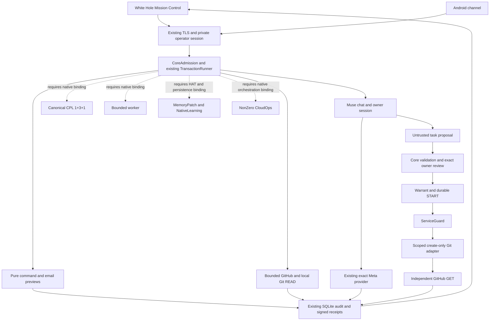

# Dependencies and activation boundaries

Base: `2be99da7aa07f7eb5faa9459fe8a78c5d0b6653a`. The graph describes one composition, not permission to activate every node.

- G0/G1: preserve source capsule, OS owner admission, host identity, transaction scope, exact warrants, UNKNOWN and no-retry contracts before any effect adapter.
- Chat/READ and pure previews do not enable worker, semantic memory, CPL or GitHub WRITE.
- Git WRITE additionally needs scoped local App configuration, current installation permission check, resolved owner liabilities and an exact live proposal/warrant. A CLI OAuth token is not a fallback.
- Native worker needs canonical orchestration/CPL binding and qualified sandbox admission; the existing OFFLINE_FIXTURE guard remains. A lambda that always approves is not a CPL integration.
- Memory/knowledge need a borrowed current transaction factory, explicit selected HAT and consent. Historical SQLite stores are not dependencies to reintroduce.
- Gmail sending needs an actual Core effect gate, current account enrollment and transport/readback contract. Pure MIME/PKCE helpers do not satisfy them.
- External legal corpus requires pinned manifest/index/source identity and provenance/rights review. Its absence does not block ordinary Native chat.
- Android build/pairing verification remains a separate channel gate; no SDK, device or alternate gateway is started for this Linux integration.
