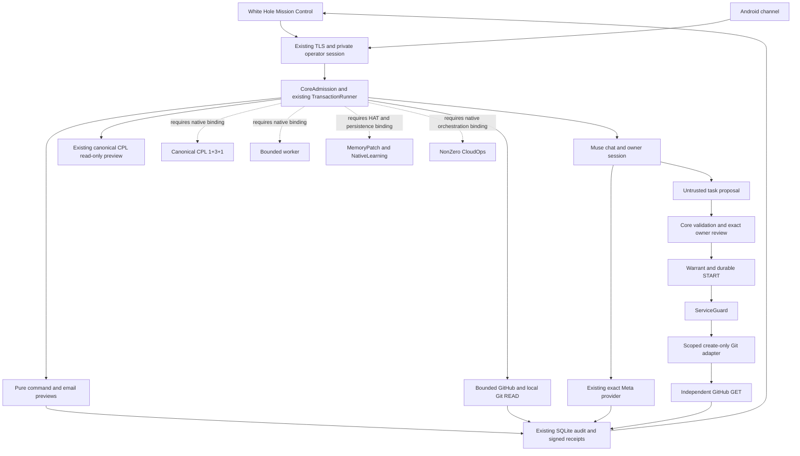

# Dependencies and activation boundaries

Base: `2be99da7aa07f7eb5faa9459fe8a78c5d0b6653a`. The graph describes one composition, not permission to activate every node.

- G0/G1: preserve source capsule, OS owner admission, host identity, transaction scope, exact warrants, UNKNOWN and no-retry contracts before any effect adapter.
- Chat/READ and pure previews do not enable worker, semantic memory, CPL or GitHub WRITE.
- Git WRITE additionally needs scoped local App configuration, current installation permission check, resolved owner liabilities and an exact live proposal/warrant. A CLI OAuth token is not a fallback.
- Native worker needs canonical orchestration/CPL binding and qualified sandbox admission; the existing OFFLINE_FIXTURE guard remains. A lambda that always approves is not a CPL integration.
- Memory/knowledge need a borrowed current transaction factory, explicit selected HAT and consent. Historical SQLite stores are not dependencies to reintroduce.
- Gmail sending needs an actual Core effect gate, current account enrollment and transport/readback contract. Pure MIME/PKCE helpers do not satisfy them.
- External legal corpus requires pinned manifest/index/source identity and provenance/rights review. Its absence does not block ordinary Native chat.
- Android build/pairing verification remains a separate channel gate; no SDK, device or alternate gateway is started for this Linux integration.

## Source-family disposition

All 31 matrix groups are classified: 11 `ALREADY_MERGED`, 6 `PORT_IN_PR46`, 11 `DEFERRED_PRESERVED`, 1 `BLOCKED_EXTERNAL`, 1 `DUPLICATE` and 1 `OBSOLETE_PROVEN`. These labels classify implementation sources, not LIVE availability. `ALREADY_MERGED` is relative to frozen main `2be99da7`; it does not say PR46 has been merged. Full source/merge-base SHAs and concrete tests are in the matrix.

| Source family | Canonical destination / dependency | Decision and excluded old runtime |
| --- | --- | --- |
| Native chat, READ, remote proposal | Existing MissionService, exact Meta provider, Core ledger | Retained; remote WRITE disabled pending App, liability evidence, exact owner warrant and separate LIVE qualification |
| Command Grammar | `meta_hackathon.advisory` → `tools.command_grammar` | Adapted pure advice; no shell executor and no authority from a classification |
| Gmail MIME, wire, OAuth intent | `communication` → same advisory audit | Adapted pure preparation; OAuth intent does not enroll an account or create a sender |
| Canonical CPL / desktop original review | `critical_loop.service/review` and existing Native pure preview | One 1+3+1 contract; original reviewer slice deduplicated, desktop runtime preserved; no five provider calls |
| MemoryPatch / historical memory hats | Existing `memory_patch.hats`, service and borrowed transaction factory | Native semantic memory inert pending selected HAT/scope/consent; old SQLiteTagStore excluded |
| Knowledge context/citations | Existing `memory_patch.retrieval.service` | Historical adaptation deferred; no old provider/subprocess stack |
| Pinned corpus | Existing retrieval + immutable corpus manifest/index/provenance | External dependency blocked; source retained, no unqualified corpus loaded |
| CPT / human comparison | Existing canonical review contracts | Deferred human comparison adapter; no separate reviewer/approval runtime |
| R3 metadata | Existing `mission.warrant` contracts | Historical metadata preserved; old registry DTOs confer no authority |
| NZ startup, backup and knowledge orchestration | Current persistence, acquisition and ingestion ports | Deferred adaptation; no old recovery, FTS/help queue or additional database |
| NonZero / later W7A repair and Git capsules | Current `nonzero_cloudops`, `mission.agent`, `git_publish` and intent/outbox | Frozen native module retained; unique later W7A slices preserved, no file effect ledger or independent Codex worker |
| Nemotron48 / NVIDIA / Nebius | Current providers and governed acquisition | Existing provider adapters retained; experiment preserved, no old knowledge.sqlite3, SMTP or provider runtime |
| Prototype observers / Companion pairing | Current fixed Native recipes and mobile gateway | Deferred source concepts; no WorkspaceStore, fixture Muse echo server or missing OriginalCoreAdapter substitution |
| Historical Bash authority classifier | Current conservative advisory grammar only | Authority use obsolete by demonstrated redirection misclassification; history preserved, no deletion |

The destination files exist; a destination is not evidence that its historical slice has already been adapted. Preserved-source rows explicitly say `NOT_BOUND`. No new transaction factory, authority scope or memory consent is inferred from this map.

## Channel work after the code release

| Channel | Source accounted for now | Separate work after merge |
| --- | --- | --- |
| Linux / Muse | One Native, current owner-session contract, temporary offline acceptance | Approved deployment of exact artifact with fresh state gate; LIVE calls only with authorization |
| Android | Existing signed pairing/Core/QR and source inventory preserved | Current physical phone/readback acceptance; no APK rebuild or signer change in this sprint |
| iOS | No new runtime or client introduced | Out of this consolidation scope |
| Gmail | Draft, exact MIME, wire and PKCE intent contracts | Account enrollment, Core sending gate and one owner-approved delivery/readback before SEND qualification |

Eight dirty worktrees and two unavailable external worktrees remain explicitly `PROTECTED` in [PROTECTED_SOURCES.csv](PROTECTED_SOURCES.csv). Their uncommitted content is not certified redundant; source consolidation authorizes no branch/worktree deletion.
