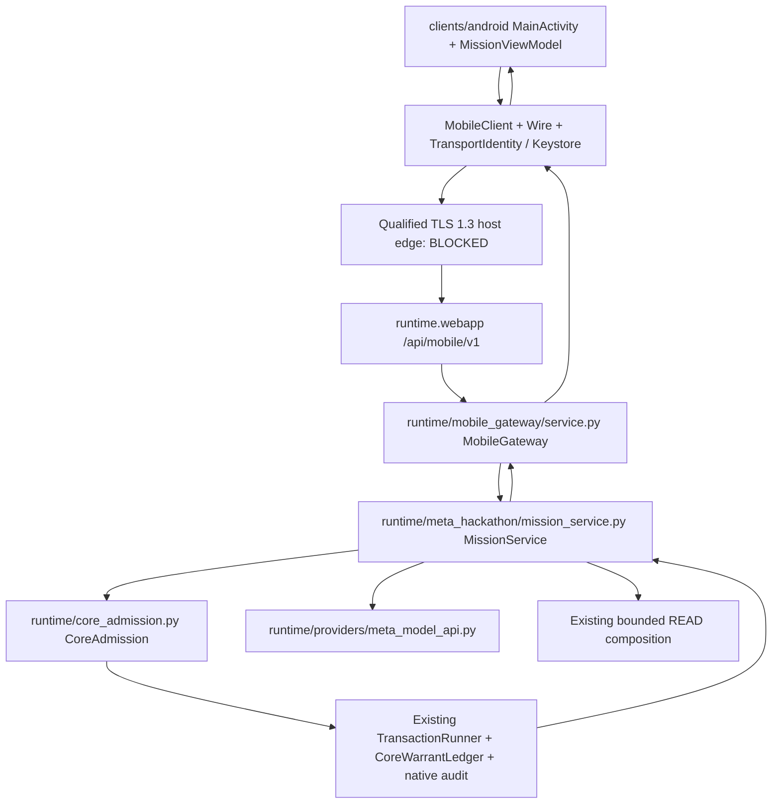

# AIOA Companion V2 — projekt integracji, bez nowego runtime

Status: **SPECIFICATION_ONLY** dla V2. Podstawa faktów: lokalny N1
`6216b16f22da167b401f8611291264d73eaacb40`. W tym zadaniu nie zmieniono
klienta Android, protokołu, Core ani usług. Dokument nie otwiera nowej
zdolności i nie oznacza gotowego APK czy telefonu E2E.

## Istniejąca kompozycja

To jeden `WebRuntimeService`, ten sam obiekt `MissionService` i ten sam Core.
`WebRuntimeService.__init__` sprawdza zgodność obiektów, a
`MobileGateway.__init__` akceptuje wyłącznie istniejący MissionService.
Obecny gateway jest włączalny tylko w jawnie oznaczonym profilu fixture;
produkcyjny enrollment pozostaje zablokowany. Android dodatkowo odrzuca
`OFFLINE_FIXTURE` i wymaga `TLS_HOST_VERIFIED` przed wysłaniem kodu enrollment.
Nawet działający test HTTP fixture nie dowodzi połączenia prawdziwego telefonu.

Referencje źródłowe: `runtime/mobile_gateway/service.py`, `wire.py`,
`runtime/webapp.py`, `runtime/meta_hackathon/{mission_service,runtime_adapter}.py`,
`runtime/core_admission.py`, `runtime/mission/warrant.py`,
`runtime/memory_patch/persistence/ports.py`, `protocol/mobile_mission_v1.json`.
Lokalny fixture używa istniejącego `DurableFactory` i native AUDIT/OUTBOX.
Nie przenosimy historycznego backendu M12 ani nie tworzymy drugiej bazy.

## Warstwy i minimalne przyszłe interfejsy

| Warstwa | Dziś | Decyzja V2 |
|---|---|---|
| UI | Jedna Activity, Compose, AndroidViewModel i `mutableStateOf(MissionUi)` | Jeden niemutowalny `StateFlow<MissionScreenState>` obserwowany zgodnie z lifecycle; migracja dopiero osobnym patchem |
| Domena | Preview, status/lista, evidence, proposal readback, scoped STOP | Jeden `MissionRepository` nad tym samym `MobileClient`; brak drugiego klienta HTTP/approval engine |
| Dane | P256 Keystore, podpisane request/response, TLS1.3 i certificate pin | Typowane DTO i jawne rozróżnienie świeżości dowodu, łączności i stanu zadania |
| Host | Webapp → MobileGateway → MissionService/Core | Kwalifikowany native TLS edge i owner admission dostarczone zaufanym kanałem hosta |
| Wykonanie | Lokalny READ fixture; istniejący provider ma osobny gate LIVE | Coding worker i GitHub WRITE pozostają osobnymi przyszłymi zdolnościami Core |

Proponowany repository oferuje `observeState()`, `refreshStatus(cursor)`,
`preview(boundedRequest, proposalId)`, `readProposal(proposalId)`,
`readEvidence(taskId)` i `requestStop(taskId)`. To **projekt interfejsu**, nie
dopisane metody protokołu. Mapowanie korzysta z istniejących tras
`/api/mobile/v1/{capabilities,enrollment/redeem,status,preview,proposals/…,tasks/…}`
oraz tras STOP/revoke opisanych w `protocol/mobile_mission_v1.json`.
Nie dodaje `run()`, `approve()`, `spend()` ani `push()` na telefonie.

Model jest wybierany jawnie: `provider_id` + `model_id` + tryb + zatwierdzona
polityka kosztu muszą odpowiadać zapisowi hosta. Meta to
`meta_model_api` / `muse-spark-1.3`; nie podszywamy pod nie historycznych
odpowiedzi Nebius. Wybór Nemotrona wymaga osobnego kwalifikowanego adaptera,
sesji/budżetu i testu w tej kompozycji; niedostępność daje BLOCKED. Obecne
N1 nie ma działającego mobilnego przełącznika providerów. Żadnego fallbacku
na inny model, fixture lub inny runtime po timeout.

Zalecenia rozdziału UI/data są zgodne z
[Android app architecture](https://developer.android.com/topic/architecture);
mapowanie istniejącego N1 na V2 jest decyzją projektu, a nie twierdzeniem,
że Google certyfikowało ten system.

## Stany ekranu i brak automatycznego retry

To projekcja istniejących faktów backendu, nie druga maszyna stanów wykonania.
Surowy `backend_state`, tryb i świeżość pozostają widoczne w dowodzie.

| Stan V2 | Warunek / zachowanie |
|---|---|
| STARTING | Brak świeżego podpisanego statusu; żadnych operacji efektowych |
| OFFLINE | Utrata łączności; ostatni dowód oznaczony nieaktualnym, nie sukcesem |
| PREVIEWED | Dokładny preview digest odebrany od hosta; telefon nie nadaje Run |
| RUNNING | Świeży podpisany stan hosta; spinner sam nie dowodzi wykonania |
| UNKNOWN | Nieznany wynik, utracony ACK lub brak rozliczenia; GET/readback, bez ponowienia POST |
| BLOCKED | Odmowa polityki, DENIED, brak ownera/TLS/zdolności albo wygasły dowód; pokazać kod i warunek odblokowania |
| STOPPED | Potwierdzony przez hosta scoped STOP; lokalne kliknięcie jest wyłącznie żądaniem |
| DONE | Terminalny wynik z powiązanym receipt; nadal osobny znacznik OFFLINE_FIXTURE albo LIVE_VERIFIED |

`DONE` nie jest obecnym enumem backendu. `OFFLINE_FIXTURE` może być
wyświetlone jako zakończony **test offline**, nigdy jako LIVE. Dla przyszłego
LIVE wymagane są receipt i niezależny readback. Wygasły status unieważnia
możliwość działania, nawet jeśli poprzedni ekran był DONE.

Przed wysłaniem preview istniejący ViewModel zachowuje tylko opaque
`proposal_id`. Restart nie tworzy nowego POST; klient odczytuje ten sam ID.
Archiwizacja lokalnej wskazówki nie czyści UNKNOWN w Core ani nie udziela zgody
na retry. Zmiana origin/sesji/źródła wymaga ponownego enrollment; odpowiedź
starszej generacji nie może odświeżyć stanu. STOP dotyczy tylko konkretnej
misji i nie jest zgodą na globalny kill innych usług.

## Granice bezpieczeństwa

1. Tożsamość transportowa P256 w Android Keystore służy podpisom urządzenia,
   nie roli ownera Core. N1 nie wymaga biometrii dla każdego podpisu;
   nie przypisujemy mu takiej ochrony. Token/code nie trafiają do backupu,
   dowodów czy modelu; na telefonie nie ma klucza Meta/Nebius.
2. Host proof: niezależnie zweryfikowany origin, TLS certificate pin i host SPKI,
   challenge, audience, source SHA, capsule/scope digest oraz termin ważności.
   Proof jest sprawdzany **przed** uwolnieniem kodu enrollment/sekretu sesji.
3. Każde żądanie wiąże metodę, ścieżkę, payload digest, nonce, sesję, czas,
   source/capsule/scope; odpowiedź musi odpowiadać temu żądaniu. Replay,
   podmiana zadania/urządzenia i source drift mają kończyć się odmową.
4. Warrant, owner approval i START należą do Core na Linuksie. Model, prompt,
   issue GitHub i telefon nie mogą ustanowić principal, budżetu ani scope.
   Istniejący profil mobile deklaruje `run=false`, `approve=false`,
   `meta_spend=false`, `native_execute=false`, `github_write=false`.
5. UNKNOWN jest trwały do niezależnego rozliczenia. Atomowość transakcji
   ledgera nie oznacza atomowości SQLite/filesystem, sieci czy GitHub.
   Reconciliation odczytuje stan efektu; nie odtwarza niepewnej mutacji.
6. Tailscale HTTPS jest przyszłym prywatnym edge po niezależnym provisioningu.
   Nie uruchomiono Serve, nie zmieniono ACL, bindingów ani chronionych portów.
   `127.0.0.1` na Xiaomi wskazuje telefon, nie Linux.

## Docelowa demonstracja i rzeczywiste bramki

```mermaid
flowchart LR
    Phone[Xiaomi: bounded task] --> Preview[Signed preview / same AIOA host]
    Preview --> Spend[Exact owner approval + budget / Muse]
    Spend --> Worker[Disposable coding sandbox]
    Worker --> Test[Tests + independent readback + diff digest]
    Test --> Review[Owner reviews exact files and hashes]
    Review --> Commit[Separate approval: commit]
    Commit --> Push[Separate approval: push exact remote/ref/SHA]
    Push --> PR[Separate approval: draft PR exact base/head]
    PR --> Evidence[GitHub URL + receipt + source/task evidence]
```

| Odcinek | Ocena na bazie N1 | Dowód / brak |
|---|---|---|
| Jedna webapp + gateway + MissionService/Core | OFFLINE_TESTED | Python HTTP/service/wire tests i fixture; produkcyjny TLS edge BLOCKED |
| Android Compose/Keystore/typed wire | ALREADY_IMPLEMENTED jako kod | Manifest/hash wejść; JVM10 przygotowane, build i fizyczny enrollment BLOCKED |
| Xiaomi → host preview/status/evidence/STOP | BLOCKED | Brak zweryfikowanego APK, TLS edge i realnego pairingu telefonu |
| Host preview → warrant → bounded READ → receipt | OFFLINE_TESTED | Istniejący jawny fixture, nie wykonanie telefonu ani Meta LIVE |
| Rzeczywista odpowiedź Muse + tool turn w tej sesji | BLOCKED | Adapter istnieje; brak osobno autoryzowanego testu/owner admission, koszt0 |
| Muse → izolowany coding worker | TO_BUILD | N1 dopuszcza READ, nie WRITE/EXEC; model nie uzyskuje uprawnień przez schemat narzędzia |
| Testy kodu/diff → niezależny odbiór | TO_BUILD dla coding worker | Narzędzia build/test same nie są receipt efektu wykonania agenta |
| Exact commit/push/draft PR z telefonu | TO_BUILD | Osobne operacje i zgody Core, credential isolation i reconciliation wymagają certyfikacji |
| GitHub URL/evidence w tej ścieżce Android/Muse | BLOCKED | Manualny draft PR narzędzi wykonany przez Codex nie będzie dowodem Android/Muse E2E |

Przyszły worker otrzymuje wyłącznie odizolowany disposable worktree, allowlistę
operacji, limit czasu/CPU/RAM/dysku oraz brak sekretów i dostępu do mountów
właściciela. Plan modelu nie jest komendą powłoki. Przed commit approval
wiąże dokładny diff, rodzica HEAD, scope i źródło; przed push także remote,
ref, SHA i brak force; przed PR dokładne base/head i treść. Zmiana któregokolwiek
pola unieważnia zgodę. Crash po push/PR wymaga odczytu serwera, nie auto retry.
To specyfikacja przyszłego kontraktu, bez uruchamiania workerów lub Git WRITE.

## Dowody i odbiór przyszłej implementacji

Receipt ma wiązać source SHA/capsule/task/proposal/tool_call ID, provider/model,
payload/target/revision/scope, zatwierdzoną operację i jej wynik/hash,
request/cost/approval receipt, START, STOP oraz odczyt rozliczeniowy. W aplikacji
pokazywać tylko przefiltrowaną projekcję; klucze, nonce/tokeny, pełne instrukcje
i prywatne ścieżki pozostają poza publicznym logiem. Nie wystarczy obecność
klasy, mock odpowiedź, animacja ani syntetyczny receipt.

Minimalna kolejność później: kwalifikacja TLS i natywnego owner channel →
rzeczywisty build + podpis + zgoda na instalację → pairing i negatywne testy
tożsamości/replay/UNKNOWN/STOP → osobno autoryzowany Muse READ → dopiero nowy
kontrakt coding/sandbox i odrębne GitHub WRITE. Każdy odcinek wymaga odbioru
poprzedniego; dokument i obecne narzędzia nie przyznają tych zezwoleń.
