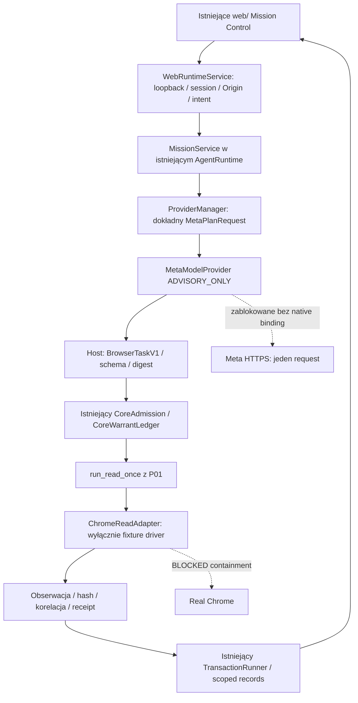

# AIOA spArkHAT — METAGuardiansSPARK: P02

Data: 2026-10-31. Mandat: lokalny `Muse_Prompt_02.pdf`, PROMPT 02/03. Raport dotyczy kodu i prób w TARGET, nie konfiguracji Codex-Muse.

## 1. Decyzja i poziom dowodów

**P02_OFFLINE_PASS.** Jedna istniejąca aplikacja przyjmuje zadanie, pokazuje plan fake Meta, wymaga zatwierdzenia dokładnego fixture READ, konsumuje warrant przez istniejący Core, wykonuje fake browser read i udostępnia trwały wynik, STOP oraz evidence. Oznaczenie: **OFFLINE_TESTED**. Fixture nie dowodzi działania prawdziwego modelu ani Chrome.

| Obszar | Poziom | Wynik / ograniczenie |
| --- | --- | --- |
| Istniejący runtime + WebRuntimeService + Mission Control | OFFLINE_TESTED | CLI i lokalne HTTP: preview/run/evidence, replay 409, STOP, poprawne zamknięcie własnego procesu |
| Meta provider, API schema i kontrola Core | OFFLINE_TESTED | Wpięcie do ProviderManager; testy na mocku; transport HTTPS domyślnie wyłączony; zero rzeczywistych wywołań |
| Meta LIVE | BLOCKED | `META_API_LIVE_BLOCKED_OWNER_GO`; brak rzeczywistego host binding, potwierdzenia Billing/typu klucza i osobnego model/cost/count GO |
| Chrome adapter | OFFLINE_TESTED | Wstrzyknięty fake, prywatny profil tymczasowy, kontrola obserwacji i hashów |
| Chrome LIVE | BLOCKED | Brak potwierdzonego drivera/egress containment i zgody na exact origins; zero uruchomień Chrome |
| Android/Companion | BLOCKED | Responsywny układ CSS; brak testu na fizycznym telefonie, APK i gateway niezmienione |
| Rzeczywisty model/browser E2E, film, zgłoszenie | BLOCKED | Poza P02; nie ogłaszać `AGENT_READY` |

Nie ma wyników `LOCAL_CHROME_TESTED` ani `META_API_LIVE_VERIFIED`. Model-shaped test z podmienionym transportem nadal jest testem offline.

## 2. Git, checkpointy i zachowanie źródeł

TARGET: `/home/l/projects/AIOA-spArkHAT-META`, branch `AIOA-METAGuardiansSPARK`, origin `https://github.com/luciferprosun/AIOA-spArkHAT.git`. Start: `34490b91ecd7f961bc98e088bd1b504e740a510a`, czysty index/worktree, P01_REUSED. P01: `5d0c62d883a231d7057a94842beb32fc2c532bb3` + `34490b9`, 186 testów Meta PASS. Nie powtarzano migracji P01.

Lokalne checkpointy P02:

1. `0c2ada5f554ce4e088c1afa22d4f679026b82511` — browser fixture adapter, typowany observer P01 i testy.
2. `c0d535ac904ffafb3eec5fba9a0ac80bedba3482` — Meta provider, kompozycja istniejącego Core/mission i testy.
3. `6fe684632b183dca334868feed3262bba26337f0` — istniejący web UI/API, status/STOP/evidence i dokumentacja.
4. Commit zamykający evidence po próbie uruchomienia checkpointu 3 — wyłącznie dokumentacja/dowody. Jego SHA: `git log -1 --format=%H -- docs/meta/migration/P02_INTEGRATION_REPORT_20261031.md`.

Kolejność browser → provider/mission → web wynika z zależności importów; zachowuje trzy osobne checkpointy kodu wymagane w P02. Ostatni checkpoint dokumentacyjny wiąże ponowioną próbę CLI z rzeczywistym commitem kodu, bez zmiany testowanych bytes. Dokładny końcowy HEAD i czystość indexu/worktree są sprawdzane po commicie w prywatnym `FINAL_VERIFICATION.json`. Nie wykonano push, pull, reset, clean, stash, merge ani rebase. Autor technicznych commitów: `Codex <codex@localhost>`, bez zmiany globalnej konfiguracji Git.

Źródło Nebius pozostaje READ-ONLY: branch `feature/nebius-nemotron-integration-20261028`, HEAD `6e9dd8ebc1dcb2c03345d9dc7d30895013751cd5`; 24 modified i **199 untracked** w aktualnym preflight, a nie historyczne 88 z PDF. Companion: branch `codex/final-connect-20261023`, HEAD `9cf6c567b40bc87385fb90e9143b0fb170889b2a`, czysty. Porównanie branch/HEAD/status przed i po pracy oraz 54 hashów z ledgera P01: zgodne. Dwa chronione pliki P01 (`mission_runner_offline.py`, `test_meta_mvp_runner.py`) pozostały identyczne bajtowo. Nie zmieniano Codex/Codex-Muse, usług, GOLD72, budżetów Nebius ani innych worktree.

## 3. Reuse i pochodzenie

Pełne source path/working-tree SHA-256 i branch/SHA: [IMPORT_LEDGER_20261031.md](IMPORT_LEDGER_20261031.md), stan źródła z 31.10.2026; historia AIOA/Nebius z października 2026. P02 nie importował kolejnych całych modułów ze źródłowego worktree.

| Materiał | Wykorzystanie w P02 | Granica |
| --- | --- | --- |
| Nebius-origin `runtime/providers/tool_calling.py`, source SHA-256 `4808817b686e7f038b09220122524624f519c3c996116ff1717f86b75a5bb23c` | Podzbiór przeniesiony w P01: strict JSON, checked, ToolCall/ToolMessage; używany przez provider i istniejący read seam | Bez przenoszenia transportu Nebius i jego cen |
| Target `mission_read_offline.py` z P01 | Dodany wyłącznie typowany observer fixture po istniejącym consume warrant | Nie staje się native READ START |
| Source `runtime/mission/{agent,warrant,intent,tools}.py` | Istniejące odpowiedniki TARGET i ich kontrakty; bez kopiowania źródłowych dirty bytes | Warrant, governor, runner i OPERATION/RECEIPT zachowują authority Core |
| Source `runtime/ui_v2/server.py`, `web/frontend-v2/{client,prototype,nebius,styles,...}` | Idee UX: konkretne preview, STOP, readback i source identity zaadaptowane do istniejącego `runtime/webapp.py` i `web/` | Cały drugi serwer/frontend pozostaje DEFER; brak byte-copy tych plików |
| Target `runtime/tools/browser_tools.py` | Idee bounded visible text/screenshot/timeout | Nie importowano globalnej sesji, click/type ani profilu użytkownika |
| `native_read.py`, `task_bridge.py`, `authority_bridge.py`, `local_zero.py`, sandbox/Git publish, Companion gateway | DEFER zgodnie z ledgerem P01 | Nie kopiowano pełnego prototype, bazy, approvals, sekretów lub runtime M12 |

## 4. Jedna kompozycja i authority

Jedna instancja `OfflineMetaComposition` składa istniejący `AgentRuntime`, `CoreAdmission`, `TransactionRunner` z istniejącym `DurableFactory`, `CoreWarrantLedger` i `ProviderManager`. Prywatny plik rekordów to istniejący adapter demonstracyjny, nie nowy approval engine lub produkcyjny backend M12. Syntetyczne `LocalOwnerAssignment(operator_approved=True)` jest ograniczone do jawnego profilu OFFLINE; **nie stanowi rzeczywistego owner admission ani prawa do wydawania pieniędzy**.

API w tym samym serwerze: `GET /api/meta/status`, `POST /api/meta/preview`, `POST /api/meta/run`, `POST /api/meta/stop`, `GET /api/meta/evidence/<task_id>`. Istniejące local-host/session-token/Origin checks i dokładne `X-AIOA-Intent` są obowiązkowe. W profilu Meta pozostałe effect endpoints są zamknięte. HTTP nie przyjmuje ownera, warrantu, budżetu ani allowlisty od modelu. Lokalna sesja UI nie jest uwierzytelnieniem produkcyjnego ownera.

Każda zapisana misja/receipt wiąże task/digest, owner scope, Git source SHA, hash kapsuły 13 plików, provider/model, deadline, budget, origins, correlation i STOP. Source SHA w końcowym dowodzie aplikacji to `6fe6846`, sprawdzony po trzech commitach kodu przy czystym worktree; dokładne bytes są osobno zapieczętowane w evidence index. Późniejszy checkpoint zamknięcia zmienia wyłącznie dokumentację. Dane modelu i stron są niezaufane. Tylko `navigate_read` zgodne z dokładnym zadaniem przechodzi walidację. Model nie wystawia approvals i nie wykonuje narzędzi.

Warrant fixture jest zatwierdzany dopiero przez osobną akcję Run operatora w lokalnej sesji. Wykonanie jednorazowe, maksymalnie jedna aktywna misja, brak retry efektów. Niepewny approval ACK/readback i restart pending → `UNKNOWN`, bez awansu do VERIFIED. Przy 1024 misjach w ograniczonym skanie dalsze operacje fail closed; nie tworzono drugiego indeksu/store. STOP anuluje wyłącznie własną misję/fixture worker.

LIVE Meta adapter wymaga rzeczywistego, zgodnego Core ledger/governor/principal, zapisanego aktywnego OWNER_APPROVAL, rezerwacji i dokładnego request digest/source capsule/policy epoch/expiry/model/cost/count. Sprawdza to **przed odczytem klucza**. Warrant jest konsumowany, a istniejący governor oznacza rezerwację UNKNOWN przed pojedynczym HTTPS. To nie obiecuje atomowości Core + HTTP ani automatycznego zwrotu środków; rozliczenie wymaga niezależnego odczytu. Domyślny provider jest DISABLED, aplikacja offline używa MOCK. Nie ma gotowego zaufanego host admission dla LIVE, a flaga smoke nie tworzy go automatycznie.

Chrome fake tworzy prywatny katalog tymczasowy, sprawdza exact URL/origin, claimed public IP, przekierowanie, zasoby, SW/WS/download i limity. Nie dowodzi to izolacji DNS/egress realnej przeglądarki. Screenshot to jawna grafika fixture o rozmiarze jednego piksela; hashe są prawdziwe dla fixture, bez renderowania Chrome. Istniejących 51 procesów Chrome z preflight nie dotykano, Playwright Python nie był dostępny; niczego nie instalowano i nie podłączano do DevTools. MCP pozostaje transportem/kontraktem; nie dodano nowej operacji browser.* ani ścieżki ALLOW → native execution.

## 5. Zmienione pliki

| Grupa | Pliki |
| --- | --- |
| Browser/P01 | `runtime/browser_agent/chrome_read_adapter.py`, `runtime/meta_hackathon/mission_read_offline.py`, `tests/test_meta_chrome_read.py` |
| Provider/Core kompozycja | `runtime/providers/config.py`, `runtime/providers/meta_model_api.py`, `runtime/meta_hackathon/mission_service.py`, `runtime/meta_hackathon/runtime_adapter.py`, `tests/test_meta_model_api.py`, `tests/test_meta_mission_service.py` |
| Ten sam web UI/API | `runtime/webapp.py`, `web/index.html`, `web/app.js`, `web/styles.css`, `web/meta_mission.js`, `tests/test_meta_web.py`, `tests/meta_mission_ui.test.cjs` |
| Raporty | ten raport, `docs/meta/P02_MUSE_CHROME_RUNBOOK.md`, `reports/meta/P02_TEST_MATRIX_20261031.md`, `reports/meta/P02_EVIDENCE_INDEX_20261031.json`, dopisek historyczny do import ledgera |

## 6. Weryfikacja i review

Meta przed: **186 PASS**. Po zmianach i poprawkach review: **228 PASS, 0 FAIL, 0 SKIP** (+42), Node **4 PASS, 0 FAIL, 0 SKIP**. Dodatkowo istniejące regresje: Core warrant 13, MCP 99, legacy Web 7, routing 14, Nebius provider 15 PASS; komendy i ograniczenia są w [macierzy](../../../reports/meta/P02_TEST_MATRIX_20261031.md). JS syntax i diff check PASS. Skan wzorców sekretów dotyczy jawnie zmienionych plików i staged bytes; nie porównywał ich z rzeczywistym kluczem.

Prawdziwy subprocess uruchomiony przez CLI na własnym loopback porcie przeszedł preview → exact Run → evidence, odrzucił replay (409), przyjął STOP drugiej misji i zakończył się kodem 0. JSON zawiera nowy `provider_receipt.binding`, zgodne task/capsule/tool_call_id oraz `live_verified=false`. To test lokalnego HTTP i klienta JS w Node; nie test renderowania/przewijania w Chrome lub na fizycznym Androidzie.

Niezależny reviewer czytał wyłącznie prywatną kopię 31 zapieczętowanych plików, bez TARGET i bez uruchamiania testów. Zgłosił R1–R4 Important i R5–R6 Minor. R5 podniesiono do Important, bo błędny wybór historycznej misji zagrażał powiązaniu evidence. Jedna runda poprawek TDD zamknęła R1–R5:

- R1: zapisane, aktywne i nieskonsumowane approval sprawdzane przed secret loaderem;
- R2: state-filter przed LIMIT w istniejącym scoped scan; historia 1100 obcych rekordów nie ukrywa active/restart barrier;
- R3: świeży source SHA **i** capsule digest związane z requestem/receiptem;
- R4: odrzucenie echa syntetycznego sekretu także po dekodowaniu JSON Unicode;
- R5: porządek utworzenia oraz zachowanie jawnie wybranego tasku w odczycie UI.

RED → GREEN i końcowe regresje wykonał główny wykonawca. Nie było ponownego niezależnego review końcowych bytes; nie deklarujemy takiej certyfikacji. **R6 Minor DEFER do P03:** przed włączeniem prawdziwego LIVE diagnostyka musi odczytywać ostatni redacted receipt z Core oraz stan Billing/UNKNOWN, oddzielając zakończone wywołanie od prawa do kolejnego. Obecne `last_api_receipt=none`, `credit=unverified` są poprawne dla faktycznie wykonanych prób P02.

Pierwsze samodzielne uruchomienia trzech legacy suites wykazały błędy bootstrapa importów oraz założenie o braku klucza w środowisku. Zachowano logi, poprawiono izolację harnessu (kanoniczny `import runtime`, usunięcie credential env wyłącznie w procesie testowym, wyłączenie discovery prywatnych plików env). Właściwe izolowane wywołania są zielone. Nie zmieniano kodu legacy, aby ukryć ten problem. Nie uruchamiano pełnego suite całego projektu, produkcyjnego Core M12, realnego Meta/Chrome ani aplikacji telefonu.

## 7. Uruchomienie, LIVE gates i rollback

Jedna komenda i pięć czynności: [runbook](../P02_MUSE_CHROME_RUNBOOK.md). Dowody, source seals, powiązanie offline receipt i hashe prywatnych logów: [evidence index](../../../reports/meta/P02_EVIDENCE_INDEX_20261031.json). Prywatny root (0700): `/home/l/projects/META_INTEGRATION_PRIVATE_20261031/20261031T143446Z`; logi/review/seals/prywatny stan nie są kopiowane do repozytorium.

Klucz Meta: exists/regular/owner/perms0600 potwierdzone z metadanych. Nie odczytywano wartości, długości ani fingerprintu. Posiadanie pliku lub deklaracja hackathonowych kredytów nie potwierdza key type/Billing. Oficjalne źródła: [overview](https://dev.meta.ai/docs/overview), [Chat Completions](https://dev.meta.ai/docs/protocols/chat-completions), [tool calling](https://dev.meta.ai/docs/tool-calling), [pricing](https://dev.meta.ai/docs/pricing-rate-limits). Adapter wykorzystuje `https://api.meta.ai/v1/chat/completions`, `muse-spark-1.3`, nested function tools i Bearer auth. Cennik standardowy odczytany 31.10: 1,25 USD wejście / 4,25 USD wyjście za milion tokenów; lokalny estimate nie jest fakturą ani potwierdzeniem salda. Nie potwierdzono niezależnie uprawnienia do 150 USD.

Rollback: zachować bieżący diff/untracked, wymagać czystego TARGET, następnie `git revert` checkpointu dokumentacyjnego i trzech checkpointów kodu P02 w odwrotnej kolejności. Pełne komendy w runbooku. Pozostawić P01 i prywatne dowody. Nie usuwać Core records i nie cofać UNKNOWN w celu retry. Bez zgody nie pushować; komenda do osobnego zatwierdzenia: `git push origin AIOA-METAGuardiansSPARK`.

## 8. Tylko Prompt 03

1. Rzeczywisty zaufany host binding Core i niezależny readback redacted receipt/UNKNOWN (R6), weryfikacja typu klucza/Billing oraz exact model/cost/count owner GO.
2. Dopiero potem jeden minimalny smoke AIOA → Meta, bez fallbacku, z usage i rozliczeniem; żadnego wykonania na podstawie samej flagi lub pliku klucza.
3. Osobny zatwierdzony driver/profil/egress i exact origins przed jakimkolwiek Chrome LIVE, następnie rzeczywisty bounded READ i niezależny readback.
4. Regresje, test fizycznego UI/Android, 2–3 min prawdziwego demo i materiały zgłoszenia. Publikacja/zgłoszenie dopiero w odpowiednio autoryzowanym zakresie.

**P02 kończy się OFFLINE_PASS; Meta LIVE i Chrome LIVE: BLOCKED.**
