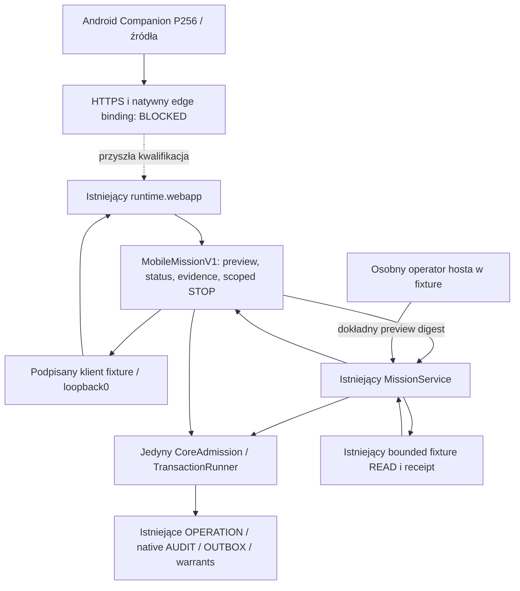

# AIOA spArkHAT | METAGuardiansSPARK — N1 overnight

**Wynik: PARTIAL. Podpisany hostowy transport i Core fixture działają; nowy APK,
fizyczny Android, produkcyjny HTTPS/enrollment i LIVE pozostają zablokowane.**
Nie uruchomiono płatnego modelu ani publicznego Chrome, nie zmieniono Tailscale,
usług, źródłowych worktree, main ani budżetu. Koszt inferencji: **0 USD**.

## Fakty i wykonane fazy

| Faza | Status | Rzeczywisty rezultat |
| --- | --- | --- |
| N0 | PASS | TARGET clean przy starcie, branch/HEAD/source map i jeden writer; bazowe Meta265/Node7/Core13/MCP99 PASS; prywatne dowody bez eksportu baz/sekretów |
| N1 | PASS | MobileMissionV1, ADR, zamknięte metody/schematy/bounds/errors, brak mobilnego Run/Approve/spend |
| N2 | PASS — OFFLINE_FIXTURE | Podpisane host proof/enrollment/request/observation, trwałe audience/session/nonce/revocation i scoped task/evidence/STOP; jeden istniejący Core/runner/audit; produkcja REMOTE_DEPLOYMENT_BLOCKED |
| N3 | PARTIAL | Neutralne źródła następnej wersji tego samego pakietu Android, Compose scroll/insets, Keystore/TLS/pins i lifecycle; SOURCE checks PASS; brak kompilacji/JVM/telefonu |
| N4 | PARTIAL | Pasywny redacted doctor, checklista Xiaomi/HyperOS i enrollment; rzeczywisty status Tailscale/new peer/HTTPS UNKNOWN; żadnych mutacji |
| N5 | PASS — HOST_GATEWAY_MOBILE_FIXTURE_PASS | Rzeczywiste podpisane HTTP loopback:0 → MissionService → host fixture approval → Core warrant consume → fixture READ → niezależne porównanie receipt/hash → scoped STOP drugiej misji → replay409 |
| N6 | PARTIAL | Zweryfikowany wrapper, deterministyczny build manifest/handoff; JDK17/SDK36/Gradle8.13 nie są kwalifikowanym lokalnym kompletem; APK_BUILD_BLOCKED_TOOLCHAIN |
| N7 | PASS w ograniczonym zakresie | Jeden niezależny review63 plików; poprawiono wszystkie6 uwag, jedna runda TDD i zielone regresje; source protection/seals i pattern secret scan; bez powtórnego review |
| N8 | PASS | Raport, migration map, test matrix, runbook/handoff i lokalny checkpoint; STOP bez GO LIVE |

## Repozytoria i zachowana praca

| Repo | Branch / HEAD przed N1 | Zachowanie |
| --- | --- | --- |
| `/home/l/projects/AIOA-spArkHAT-META` | `AIOA-METAGuardiansSPARK` / `7387d823f38d1bc4ca964788ae11441d29b6ae6e` | jedyny TARGET; origin `https://github.com/luciferprosun/AIOA-spArkHAT.git`; zachowane P01–P03 i historia, bez pull/reset/clean/stash/merge/push |
| `/home/l/projects/AIOA-spArkHAT-Companion` | `codex/final-connect-20261023` / `9cf6c567b40bc87385fb90e9143b0fb170889b2a` | read-only; HEAD/branch/status niezmienione |
| `/home/l/AIOA_LOCAL_WORKTREES/aioa-android-agent-lab-20261028` | `feature/aioa-android-agent-lab-20261028` / `fb8642f108aea7db5db7a0b1446d4145f4167991` | read-only; HEAD/branch/status niezmienione |
| `/home/l/AIOA_LOCAL_WORKTREES/nebius-nemotron-integration-20261028` | `feature/nebius-nemotron-integration-20261028` / `6e9dd8ebc1dcb2c03345d9dc7d30895013751cd5` | zastane24 modified +199 untracked zachowane; pełne nazwy w prywatnym before/after JSON; HEAD/branch/status zgodne |

Nie zmienił się żaden z76 wybranych hashy źródeł. To weryfikacja wybranych plików
i Git status, nie hash całych prywatnych worktree. Stary APK12592824 bajty zachowano:
`43943d19196d26e3be93015d1d6f1cad87a49f94015978ce40afa7ccce4725c6`.
Nie kopiowano go do nowego klienta ani nie zastępowano wydania. Lokalny ref
`refs/heads/main` nie istnieje w TARGET; żaden main/origin ref nie był aktualizowany.

Checkpoint A: `d3c731d712face460a0a7588ce08bfc45a9090f4`.
Checkpoint B: `206b8d0ef10eeb06f63bf12e088dcfc08744e0c2`.
Końcowy checkpoint C zawiera poprawki review i ten raport; jego rzeczywisty SHA,
czysty status, hashe i uruchomienie fixture po commicie są w prywatnym
`FINAL_SEAL.json` i `FINAL_DEMO.json`, a także w końcowym komunikacie.
SHA raportu nie jest wkładany do jego własnego commita.

## Jedna aplikacja i granice authority



Transportowa tożsamość telefonu nie jest owner identity. Kod enrollment jest
prebound do konkretnego SPKI, wydawany tylko przez native host-only port
sprawdzający istniejący sealed OWNER_APPROVAL principal. W teście ten principal
pochodzi z jawnego **OFFLINE** Core admission, nie z autentycznego produkcyjnego
ownera. Zwykła sesja mobilna nie wystawia warrantu, nie ustala kosztu i nie ma
portu Run/Approve/native execute/GitHub write/chat/Meta spend/M12 pairing.
Tekst modelu, polecenie lub dokument nie stają się authority.

Przed dispatch zużywany jest nonce w istniejącej transakcji; każda rewizja
transportowego rekordu ma native AuditEvent/hash chain i OUTBOX. Nie ma nowej
bazy misji, approval engine, journala ani model routera. OUTBOX jest **PENDING**;
nie ma automatycznego writera ani deklaracji publikacji Core JSONL.
Markery propozycji i Core preview to osobne transakcje: crash może zostawić
osieroconą propozycję i UNKNOWN/readback-required. Nie deklarujemy wspólnej
atomowości Core i filesystem/network ani automatycznego ponowienia POST.

Kody TTL≤300s, sesje600s, nonce±30s, observation≤30s, request16KiB, response64KiB,
strona≤16 misji. Status ma jawny cursor i liczbę własnych misji; test odczytał
całą128-elementową historię, bez wycieku cudzych zadań. Limit lokalnego profilu:
128 enrollment/session/task-link records,512 żądań na sesję i istniejąca kwota
native audit1024; po wyczerpaniu odmowa, bez automatycznej retencji lub kasowania.
To ograniczony demonstrator, nie gotowy magazyn produkcyjny.

Android weryfikuje TLS1.3/systemCA/hostname, cert SPKI i niezależny host identity
SPKI, challenge/origin/audience/source/capsule oraz podpis i digest odpowiedzi.
Odrzuca profil fixture; produkcyjnych kodów nie można wydać w N1. Token jest
wyłącznie w RAM, nowy Keystore P256 transport key po reinstalacji, backup/transfer
wykluczony w źródłach. Nie odtwarza się klucza/owner identity AGM.
Foreground FRESH ma deadline monotoniczny; timeout, utrata sieci i late callback
nie dają fałszywego sukcesu. Jawne archiwizowanie opaque UI ID zachowuje go jako
nierozliczony i **nie zmienia UNKNOWN w Core** ani nie wysyła retry/zgody.

## Testy, review i dowody

Wykonano **489 TARGET Python PASS (0 FAIL/0 SKIP)**: Meta323, Core warrant13,
MCP99, audit compatibility4, persistence ports26, native lifecycle24.
Dodatkowo **51 Companion PASS** w prywatnej kopii; **10 Node PASS** (7 istniejących
UI i3 Android SOURCE). Android: **10 Python SOURCE PASS, 10 JVM przygotowanych
NOT_RUN**; nie sumować source subset ponownie do Meta323. Nie uruchomiono JDK,
Gradle/lint/assemble/signature ani telefonu. Szczegóły i komendy:
[`N1_TEST_MATRIX.md`](../../../reports/meta/mobile/N1_TEST_MATRIX.md).

Jedna niezależna recenzja ujawniła4 Important i2 Minor; wszystkie otrzymały
rozstrzygnięcie i poprawki. Zachowano pierwotne **With fixes / production NO-GO**;
późniejszych zmian nie przedstawiamy jako ponownie niezależnie zatwierdzonych.
Przebieg RED/GREEN, regrade świeżości/odzyskiwania oraz każda odłożona kwestia:
[`N1_REVIEW_DISPOSITION.md`](../../../reports/meta/mobile/N1_REVIEW_DISPOSITION.md).

Odtwarzalny test, który uruchamia i zamyka własny serwer na wolnym loopback0:

```sh
cd /home/l/projects/AIOA-spArkHAT-META
python3 -B tests/demo_mobile_fixture.py
```

Wynik jest `HOST_GATEWAY_MOBILE_FIXTURE_PASS`, z taskID, task/source/capsule/scope
digestem, `muse-spark-1.3`, receipt SHA, zużytym fixture warrantem, STOP drugiej
misji i replay409. `verified:false`, `live_verified:false`, `phone_paired:false`
pozostają prawdziwe. Nie jest to emulator ani realna odpowiedź modelu Meta.
N7 przed końcowym commitem: task `meta-847387f5b3024f8ba86caf51bef7ee6c`,
source `206b8d0ef10eeb06f63bf12e088dcfc08744e0c2`, capsule
`1eee716c448c4c14b0cdfd9365a1fedbe1261985b5ad5fee6987e9bcb17e38f8`,
receipt content SHA `135332222afecf8400385eb7642d67bdeb1a249c28860aed754c1231d42d5e87`.
Końcowy ponowny fixture wiąże już końcowy SHA, w `FINAL_DEMO.json`.

Indeks plików, hashy logów i dokładne ścieżki:
[`N1_EVIDENCE_INDEX.json`](../../../reports/meta/mobile/N1_EVIDENCE_INDEX.json).
Prywatny katalog0700 poza Git:
`/home/l/projects/META_MOBILE_PRIVATE_20261031/N1_20261031T212814Z/`.
Skan wzorców nowych tekstów nie znalazł credential/private-key patterns;
publiczny wektor zawiera tylko testowy SPKI i podpis, klucz prywatny odrzucono.
To kontrola wzorców, nie dowód braku każdego możliwego sekretu.

## GO / NO-GO i ryzyka

| Bramka | Decyzja / pozostała czynność |
| --- | --- |
| Lokalny signed transport / Core fixture / regresje | GO w opisanych limitach, po poprawkach wykonawcy |
| Źródła Androida | CONDITIONAL GO; build/JVM/lint/merged manifest na kwalifikowanej maszynie |
| APK / podpis / aktualizacja | NO-GO; brak nowego artefaktu i porównania certyfikatów; zachowany stary APK |
| Produkcyjny owner admission / TLS edge / enrollment | NO-GO; brak rzeczywistego binding i natywnego adaptera; samo Serve/adres nie wystarczy |
| Xiaomi, pairing, Keystore, backup runtime, LTE | UNKNOWN / NO-GO; najpierw zweryfikowany build i osobna decyzja właściciela dotycząca instalacji |
| Real Muse/Billing | BLOCKED_EXTERNAL; zero wywołań, brak nowej zgody/budżetu, billing UNVERIFIED |
| Public Chrome/egress | BLOCKED_EXTERNAL; brak nowej kwalifikacji containment/authority |
| M12/STORAGE_UNSAFE / release signing / produkcyjne approvals | DEFERRED; nie dotykano ani nie certyfikowano |

Ryzyka: brak kompilatora pozostawia zgodność Kotlin/API niezweryfikowaną; brak
native edge nie może być zastąpiony flagą ani proxy header. Rotacja host key
wymaga nowego enrollment; UNKNOWN wymaga rozliczenia bez replay. Historia i audit
mają jawne kwoty, a dalsza publikacja/retencja wymaga istniejących native portów
oraz osobnej kwalifikacji. Testy źródeł UI nie dowodzą przewijania na Xiaomi.

## Konkretne dalsze kroki, bez wykonywania ich w N1

1. Wykonać `ANDROID_BUILD_HANDOFF.md` na maszynie z kwalifikowanym kompletem
   JDK17/SDK36/build-tools35.0.0/Gradle8.13/cache; sprawdzić JVM10/lint/build,
   merged manifest, podpis i SHA. Nie uruchamiać wrappera przy brakującym cache.
2. W osobnej fazie zmapować autentyczny owner/edge port hosta; jeśli brak
   dowodliwego binding, zachować NOT_BOUND. Minimalny przyszły zakres:
   native qualified-edge adapter w `runtime/mobile_gateway/`, jego wstrzyknięcie
   do `service.py`, ściśle ograniczony binding exact HTTPS origin w istniejącym
   `runtime/webapp.py`, negatywne testy proxy/peer/pins/expiry. Bez drugiego serwera,
   bazy approval, owner flags lub włączania Run z telefonu. Nie wdrożono tego kodu.
3. Operator przygotowuje Xiaomi/Tailscale i niezależnie porównuje tożsamości;
   po qualified edge i właściwym admission nowy prebound code≤5min, real signed
   status/Preview, osobna host zgoda na fixture Run, evidence/STOP, następnie
   read-only LTE/revocation test. Żadnego kopiowania sekretów AGM.

Źródła i licencje: [`NIGHT_N1_MIGRATION_MAP.md`](NIGHT_N1_MIGRATION_MAP.md).
Rollback: nie podłączaj opcjonalnego gatewaya, zachowaj operator state i dowody;
ewentualny odwracalny lokalny revert tylko commitów N1 po przeglądzie HEAD/status,
bez reset/clean. Nie wykonano rollbacku ani publikacji.
Poranny skrót: [`OWNER_MORNING_HANDOFF.md`](OWNER_MORNING_HANDOFF.md).

**STOP. Brak przejścia do GO LIVE, dodatkowych agentów nocnych lub oczekiwania na właściciela.**
