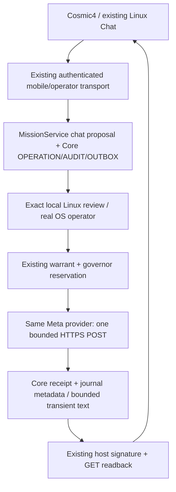

# Cosmic4 Meta Chat — one existing Core

## Intent and authorization

Implement the supplied `AIOA_Cosmic4_Meta_Muse_FINAL_PROMPT_2026-11-03.pdf`: a real advisory Muse chat shared by the already paired Android and the existing Linux Mission Control. The owner requested autonomous implementation, tests, an in-place update and deployment; another design-choice approval round is explicitly waived. Paid inference still needs a separate exact financial approval. No main merge or hackathon submission.

Baseline:4c00d7bb35185eaba0e8a1a84418c49f39d21a84, installed APK6e018c8/code400/certificate3aa33eda63d3516010ddbf0fe0ff8de6b6dab6f6fc48088ee2592bde3b627bc4. Live Native PID1178571 uses frozen5fae310 and the existing private state/TLS/host key. Original and Cosmic4 pairing are preserved. Development is isolated in `feat/cosmic4-muse-chat-20261103` so live source seals cannot be invalidated by editing or commits.

## Chosen composition and alternatives

Use `MetaModelProvider.chat_text` beside its existing plan method, the same `_https_once`, `MetaLiveBinding`, `CoreWarrantLedger`, `CoreDualGovernor`, `MetaCallRecords`, `MetaReceiptView`, `MissionService` workers/cancels, `TransactionRunner` and existing Core record factory. Do not reinterpret chat as BrowserTask/plan; define a typed advisory chat task/request and a distinct `META_CHAT_TEXT_V1` spend operation. Keep existing planner operation/receipts backward compatible.

Rejected: a second provider/backend/store/agent, calling Meta from Android, disguising ordinary text as a tool plan, copying M12, granting a financial session from HTTP, embedding an API key or session in APK, replacing Codex with another coding platform.

## Provider and finance

- Model `muse-spark-1.3`, standard Chat Completions `https://api.meta.ai/v1/chat/completions`; no fallback, contributor mode, tools or built-in search. `reasoning_effort=low`, `max_completion_tokens<=512`, `stream=false`, `n=1`, existing bounded transport/timeout<=15s.
- Request binds task/request/thread/device, actor, owner scope, source/capsule, trusted history digest, exact payload, deadline, model, provider, budget and max-attempts1.
- A typed `MetaChatTask` is advisory data, not a BrowserTask or execution grant. `MetaLiveBinding.check` explicitly accepts only the two trusted request types and derives their distinct sealed operation; all existing source/approval/revocation/epoch/governor checks remain.
- Current published standard prices are1.25USD input /4.25USD output per million tokens. Estimates use existing conservative byte+framing input bound and completion cap; usage-rate estimates are never invoice/known credit balance.
- A profile policy ceiling is not spend permission. Every call needs a stored, unrevoked exact owner warrant. The governor reserves the conservative bound, holds UNKNOWN after dispatch, and may pessimistically settle the entire bound against a real receipt. No automatic refund, larger budget, second POST or new approval after UNKNOWN.
- New profile's aggregate ceiling0.05USD; per request<=0.05USD. This is a maximum configuration, not authorization of the first LIVE call. Local owner financial review separately confirms exact request/cost/count/key type/billing; existing policy may still deny.
- 400 is a contract error,401/403 auth,402 billing,429 rate limiting,5xx unavailable; uncertain network/timeout/parse/usage/model mismatch remain UNKNOWN with readback. Preserve receipt metadata and exact provider completion/request ID when present; do not invent one.

## Journal, history and scope

Add a small chat component to the existing MissionService, delegated as other operation modules are. Use the existing OPERATION/RECEIPT/AUDIT/OUTBOX/CAS ports and existing worker/cancellation maps. States: PENDING(owner approval), RUNNING, SUCCEEDED, FAILED, UNKNOWN, STOPPED. Recovery never resumes a paid operation.

Durable journal records retain IDs, request/text/history digests, source/device/scope, state, usage and receipts. Prompt/response text and the trusted conversation window are bounded process-memory data with TTL; max20 messages and a shared byte bound. Restart/expiry produces explicit HISTORY_EXPIRED/UNKNOWN rather than reconstructing a paid request. Save knowledge remains OFF. No separate knowledge DB or journal.

Android supplies only schema/thread/request/model/prompt/max_budget. Device/session/nonce/source/capsule are normalized from the existing verified signed envelope, not caller-controlled duplicate authority fields. GET authorization checks durable device ownership before lookup. Reconnect may rotate session IDs while retaining device/thread ownership; it does not change a paid request's frozen approval.

## API and clients

- Existing router: POST/GET `/api/mobile/v2/chat`; GET `/chat/requests/{hex32}`, GET `/chat/threads/{hex32}`. Add exact read/STOP routes if needed; no mobile `/approve`, `/run` or spend-elevation route.
- Existing Native profile stays unchanged. Explicit `NATIVE_ADVISORY_CHAT_V1` is configured in the same `NativeMobileComposition` after actual PolicyKit; same OwnerScope/host/state preserve pairing. Chat capability requires actual provider/key configuration and functioning gated cost path, not a fixture flag. All native_execute/GitHub WRITE/install/browser-write/owner-approve capabilities remain false.
- Phone Send creates a stable ID once, commits the opaque pending ID before POST, and then only polls/refreshes GET. It initially shows PENDING_OWNER_APPROVAL; UI never grants cost. Lifecycle/session loss invalidates freshness but preserves recovery IDs; no automatic POST replay. Android and Linux show the same thread, actual response/provider/usage/receipt or explicit failure.
- Linux reuses `web/index.html`, existing device console, CSS/tokens and JS. Add only a chat transport/view module; model text uses textContent, never innerHTML. Unavailable Worker/GitHub actions stay disabled with actual reasons. Repository source/branch facts may be shown as local READ; remote GitHub access is never inferred from a URL.
- Exact financial approve is private native operator CLI/socket only. The HTTP operator allowlist may expose chat proposals and reads, never chat cost approval. A Linux approval link/command contains public IDs/digests only and opens trusted local review with actual PolicyKit and human financial confirmation; no auto-yes option.

## Browser bootstrap security

The inherited launcher renders a private one-use delivery and CSRF carrier in HTML. The new PDF explicitly prohibits tokens in HTML, so the updated native console must remove that carrier, retain one-use private socket admission/TTL, deliver bootstrap only over an owner-private Chrome DevTools pipe, and use an HttpOnly Secure SameSite session cookie plus an authenticated same-origin JSON CSRF bootstrap. No token in URLs, process arguments, localStorage, HTML or logs. No TCP debugging listener, TLS bypass or disabled browser sandbox. Existing operator transport/grant is reused, not a second approval service.

The launcher manages only its recognized AIOA browser profile; other browsers/processes are preserved. Native tests cover expiry/replay/cookie/CSRF/origin/rotation and denial of financial approve over HTTP. Real headful Chrome acceptance is required separately from fixture tests.

## Android update and deployment

- Same package `eu.sparkhat.aioa.companion.cosmic4`, same persistent signer; code401/version4.1.0-cosmic. Confirm actual installed version/certificate first. Build the existing variant/pipeline,35min per CI run,128MiB,1day retention; no giant local Gradle/emulator or SDK installation.
- Extend the exact branch/channel allowlist for the reviewed derivative; preserve original-package signature checks, STRICT and reviewed DEBUG image/SDK/download policies. Real testCosmic4UnitTest/lintCosmic4/assembleCosmic4 and independent APK verification precede `adb install -r`.
- No uninstall, clear-data, pairing reset or new package. Compare data/key identity before/after update and verify actual reconnect without enrollment.
- Backend first tested in hermetic composition/private test state. Only then gracefully replace the recognized deployment PID at4317, same state/host/TLS/origin/owner scope, after source admission through real local operator. Keep4314/4316/4321 and private Tailscale Serve unchanged. Do not copy old DBs into tests or restore live snapshots.
- Add all changed authority/client files to source seals. Freeze the approved deployment checkout before admission. Rollback uses prior code and the same state/TLS, never deletes approvals or replays pending effects; unknown paid attempts remain unknown.

## Acceptance / external gates

First complete offline/provider/journal/mobile/UI security tests and actual APK update/reconnect. Prepare the exact phone question “Jaki jest stan AIOA Core?” and local financial review; only the owner's separate conscious approval allows one <=0.05USD LIVE call. Verify real model/usage/receipt, actual Android answer and same thread in actual Linux Chrome. Key configured is not a billing/credits/LIVE claim.

P1 follows only after real P0. Current Native inspection-only runtime and MCP bindings are fixture-limited; do not relabel them Native. Reuse a genuinely admitted READ Worker if available, otherwise `MISSION_READ_BLOCKED` with its exact missing binding, no AGENT_READY. No WRITE/EXEC or second paid call without a new exact authorization.

Final gates: APK_UPDATE_IN_PLACE, ANDROID_RECONNECT, MUSE_LIVE_CHAT, LINUX_CHAT, MISSION_READ, SECRETS_AND_APPROVAL, SOURCE_AND_CI; DEMO_READY only with real1–4/6–7. Deliver `CODEX_FINAL_META_ANDROID_MUSE_20261103.md`, exact artifacts/source/cert/CI, redacted evidence and reopen/rollback commands. Keep PR draft/release owner gate, no merge.

## Primary references checked

- https://dev.meta.ai/docs/cookbook/quickstart-chat-completions
- https://dev.meta.ai/docs/protocols/chat-completions
- https://dev.meta.ai/docs/api-reference
- https://dev.meta.ai/docs/pricing-rate-limits
