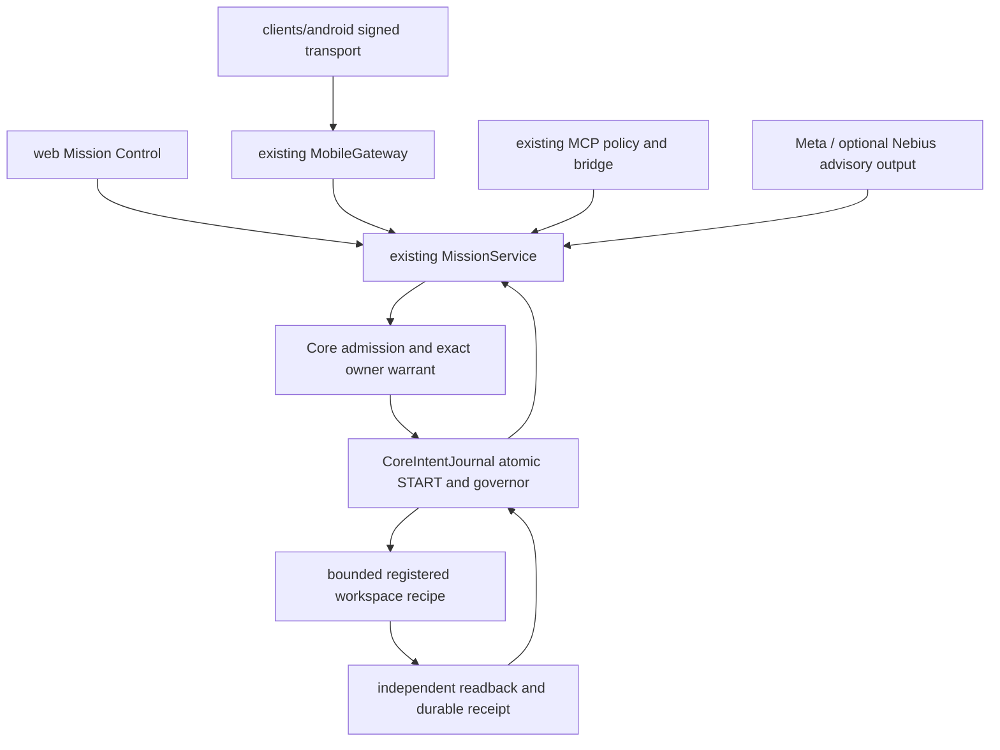

# U1 — jedna kompozycja produktu

`runtime.webapp.WebRuntimeService` pozostaje jedynym serwerem/startupem.
Lokalny profil używa istniejącego DurableFactory copy-on-write/core-records.json
przez ten sam TransactionRunner. To fixture store, bez certyfikacji CockroachDB,
Core M12 lub wieloprocesowego storage produkcyjnego.
Istniejący `MissionService` zostaje rozszerzony o typowane misje lokalne.
Jeden `CoreAdmission`, `CoreWarrantLedger`, `CoreIntentJournal`, `CoreDualGovernor`,
`TransactionRunner` i natywny AUDIT/OUTBOX. Nie powstaje druga baza ani approval engine.

Wersjonowany lokalny START USD0/risk v2 rozszerza ten sam journal.
Dotychczasowy v1 wymaga nadal dodatniej rezerwacji; nie rezerwujemy fikcyjnych pieniędzy.
Transakcja sprawdza bieżący Core, owner witness, sesję, revocation, expiry i policy epoch,
konsumuje warrant, rezerwuje realne jednostki ryzyka i zapisuje UNKNOWN + outbox przed efektem.
Utrata ACK nie daje dispatch; duplicate/restart nie ponawiają efektu.
Niezależny verifier rozlicza istniejący intent i governor. Brak atomowości DB+filesystem.

Typy: READ, WORKSPACE_WRITE, SANDBOX_EXEC, DEPENDENCY_INSTALL, GIT_COMMIT,
GIT_PUSH, GITHUB_DRAFT_PR. SYSTEM_INSTALL/BROWSER_EXTERNAL: DENY.
Każda operacja wiąże dokładny task, source SHA/capsule, principal/session,
workspace/device, target/revision, manifest/diff, scope/nonce/expiry, risk/budget i operation id.
Model, MCP i Android nie wytwarzają owner principal ani zgody. Lokalny kanał hosta
zatwierdza konkretny digest. Mobilny klient proponuje i obserwuje NEEDS_HOST_APPROVAL.

Profil offline ma jawnie syntetyczne admission i model; rzeczywiste lokalne efekty
oraz readback są oddzielnym dowodem. NIE oznacza to produkcyjnego owner binding,
Meta LIVE, zdalnych GitHub writes, APK, TLS ani uprawnień telefonu.
Oryginalne kontrakty N1 oraz Meta spend/source/UNKNOWN pozostają zachowane.
